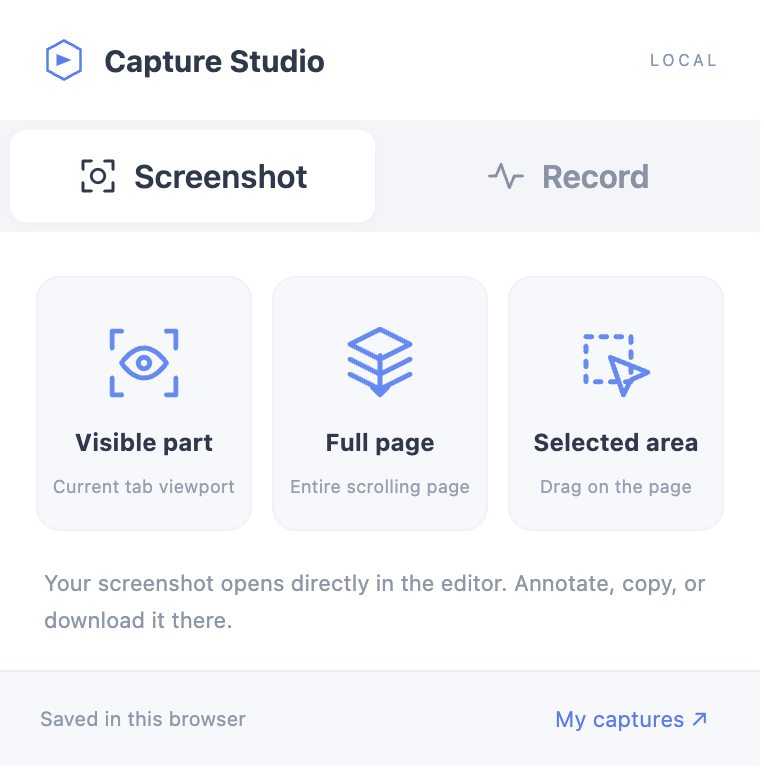

# Capture Studio

Capture Studio is a local screen recorder and screenshot tool for desktop Chrome and Edge. Use it on your own machine when you want a specific capture feature without subscribing to a commercial extension.

This repository is AI-assisted development. The recorder layout follows a public Awesome Screenshot-style interface and a supplied screenshot. The code here is independently written. Captures stay in the browser that created them.

## What you can do

- Record a screen, window, browser tab, camera, or a cropped area.
- Mix microphone audio with system or tab audio when the browser provides it.
- Aim for 720p, 1080p, 1440p, or 4K, at 24, 30, or 60 fps, and 2–32 Mbps.
- Save WebM, or MP4 when the browser can encode it.
- Annotate a screenshot with pen, shapes, arrows, text, solid redaction, and crop, then copy or download a PNG.
- Keep a local library with rename, delete, and download.

The website handles recording and single-source screenshots. The companion extension adds visible-tab, full-page, and selected-area screenshots, and it keeps a recording running after the popup closes.

## Run it locally

### Website

From the project root:

```bash
python3 -m http.server 5173 --directory dist
```

Open http://localhost:5173 in desktop Chrome or Edge. A hosted copy, when you have one, is the same app over HTTPS.

The browser asks you to choose a source each time. Keep the page open while recording. Background tabs can be throttled, and a long recording uses memory. Download captures you want to keep. Browser storage quota varies.

### Extension

Chrome 116 or newer is required.

1. Open `chrome://extensions` or `edge://extensions`.
2. Turn on Developer mode.
3. Choose **Load unpacked** and select this project's `extension` folder.
4. Pin Capture Studio.

**Screenshot** offers Visible part, Full page, and Selected area. Each mode opens one editor tab.

**Record** offers Desktop, Camera only, Browser tab, and Custom area, plus microphone, source audio, camera overlay, quality, frame rate, format, bitrate, and countdown. **Start recording** begins the capture. Close the popup if you want; reopen it to pause, resume, or stop. Desktop capture opens a small source-picker window. Leave that window open until the recording is saved.

After you change extension files, click Reload on the extensions page. Downloads use the browser's configured download folder.

## Limits

Resolution, frame rate, and bitrate are targets. Output keeps the source aspect ratio, uses even dimensions, and does not upscale a smaller source. Screen and tab audio depend on the operating system and the share picker. MP4 stays disabled when MediaRecorder cannot encode it.

There is no account, cloud upload, remote sharing, or third-party integration. Browser-internal pages cannot be captured. Full-page screenshots stop at 16,000 CSS pixels per side, and very large results are resized to at most 40 million pixels. Fixed and sticky elements are hidden after the first slice and restored afterward. Pages that keep changing, or that scroll inside their own containers, may still need a manual capture.

Feature details and the recorded checks live in [docs/features.md](docs/features.md) and [docs/verification.md](docs/verification.md).

## Layout

- `dist/` is the website: HTML entry points, scripts, and styles.
- `extension/` is the unpacked Chrome and Edge extension (manifest 1.4.2).
- `tests/` holds development browser checks. They are not part of the extension package.
- `docs/` holds feature notes and the verification record.
